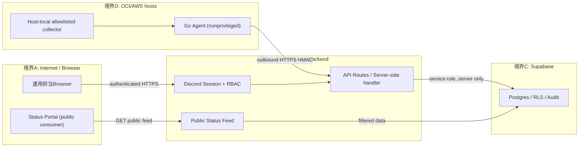
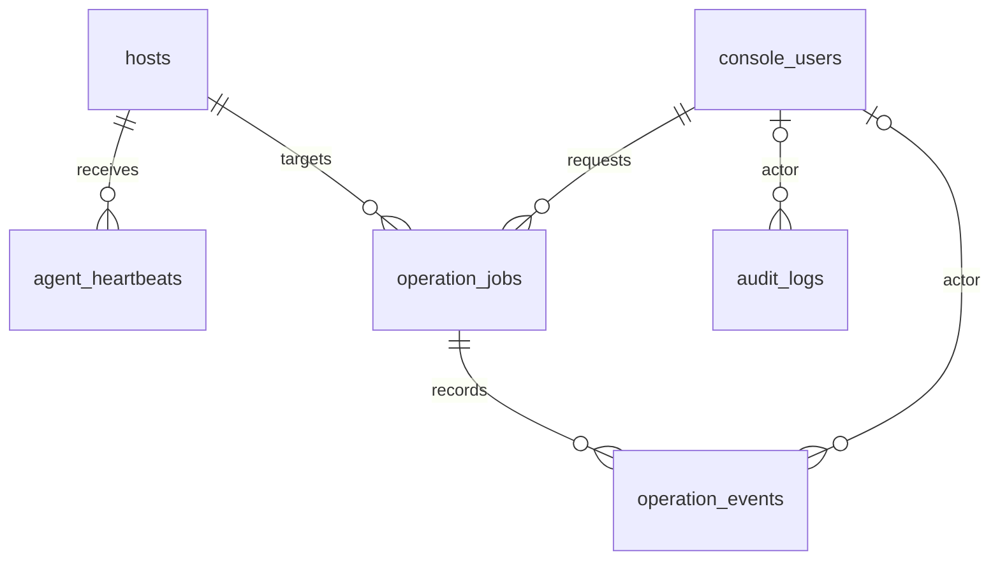
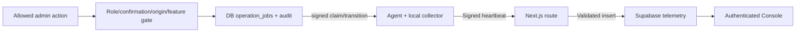
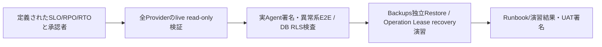

# IVRM Dashboard — システム仕様・API/DB/ER・運用/受入

Reviewed: 2026-10-26 JST. Source: `apps/web/app/api/**/route.ts`、`supabase/migrations/*.sql`、`apps/agent`、`.github/workflows/ci.yml`、[原設計](architecture.md)。以下は**mainの実装に存在する機能/代表モデル**であり、Provider内での本番接続・運用開始・実測UATの証拠ではない。

## 1. 要件定義・境界

- 内部運用者が `console.ivrm.jp` からOCI/EC2/Lightsail等のホスト、Minecraft（TPS/MSPT）、コンテナ、History、Incident/Backup/Notification/Reliabilityなどを監視する。
- Discord認証されたConsole Role（viewer/operator/administrator/owner）に対してサーバー側で権限を強制する。
- Agent側メトリクスは外向きHTTPS + HMAC署名・Nonce保護で受付。Collectorがroot権限を必要とする処理と非特権Agentを分離する。
- 実際の運用操作は、許可対象/role/再確認/Idempotency/監査/Leaseにより制約し、任意shell、無制限Docker socket、RCONをInternetへ公開しない。
- 公開ステータスと管理Consoleを分離。`/api/public/status-feed` は公開済みCMSのみを出し、管理Credential/内部UUIDを返さない。

## 2. 基本設計・構成/ネットワーク/信頼境界

This is a **logical deployment model**. Live Vercel Deployment SHA、Supabase project/migrations適用、Cloudflare Access/Route、Agent host allowlist/Roleの実値はProviderのread-only確認が必要。

## 3. 詳細設計・API仕様（代表Route、網羅表ではない）

| Method | Endpoint | 認証/境界 | 実装 |
| --- | --- | --- | --- |
| GET | `/api/health` | HTTP health check、DB readinessは別 | `apps/web/app/api/health/route.ts` |
| POST | `/api/agent/heartbeat` | HMAC/nonce/timestamp/body limit; Supabaseへ保存 | `apps/web/app/api/agent/heartbeat/route.ts` |
| POST | `/api/agent/operations/claim` | Operation Agent signed request + lease owner | `apps/web/app/api/agent/operations/claim/route.ts` |
| GET, POST | `/api/operations/jobs` | Discord session・role・confirmation・idempotency・feature gate | `apps/web/app/api/operations/jobs/route.ts` |
| GET | `/api/security/discord-sessions` | administrator以上、Discord session必須 | `apps/web/app/api/security/discord-sessions/route.ts` |
| GET | `/api/public/status-feed` | 公開用に内容を制限、15秒TTL+SWRevalidate60秒 | `apps/web/app/api/public/status-feed/route.ts` |

詳細status code/JSON/例外処理はOwnerのroute sourceで確認。Backendでの権限判定をClient/Sidebarで代替しない。Agent側の送信署名は [architecture.md](architecture.md) の`X-IVRM-Agent-ID/Timestamp/Nonce/Signature` と実コードが正本。

## 4. DB設計書・テーブル定義書 / 代表ER

Column定義・制約はmigrations SQLが正本。最新migrationのproduction applyは**未確認**。

| Table | PK | FK/unique / role | Migration |
| --- | --- | --- | --- |
| `public.hosts` | `id uuid` | `server_id UNIQUE`、provider enum | `202607300001_initial_observability.sql` |
| `public.agent_heartbeats` | `id bigint` | `host_id -> hosts.id`、resource / uptime / 受信日時 | `202607300001_initial_observability.sql` |
| `public.console_users` | `id` | Operator identity、role | `202608030001_console_users.sql` |
| `public.operation_jobs` | `id uuid` | `host_id -> hosts`, `requested_by -> console_users`, idempotency hash | `202608040001_operation_job_audit_foundation.sql` |
| `public.operation_events` | `id bigint` | `job_id -> operation_jobs`, optional `actor_user_id -> console_users` | 同上 |
| `public.audit_logs` | `id bigint` | `actor_user_id -> console_users`; hash chain | 同上 |
| `public.audit_log_chain_state` | `singleton boolean` | Audit chain anchor/state（FK関係ではない） | 同上 |

- Agent Heartbeatはhost行LockとNonceのDB Uniqueで原子性・Replayを保証（`docs/architecture.md`とmigration参照）。
- `operation_jobs`には状態値`queued/leased/running/succeeded/failed/cancelled/expired`のCHECKがあり、二重操作防止Indexとleaseがある。
- Operation Eventsは改ざん抑止のTrigger、`audit_logs`はchain hash整合性などの安全制約を保持する。**検証済み改ざん耐性の証明ではない。**
- 他の多数のmigration（Backup/Incident/Reliability/Notification）を上記抜粋で代用しない。すべての現行DBカラム/関係を生成するにはDDL sourceの全migration順序/変更履歴を追跡する。

## 5. 業務フロー（AS-IS / TO-BE）

AS-IS (Code path):

TO-BE (改善案、未受入):

## 6. テスト計画・結果記録・不具合管理・受入

| ID | Case/合格条件 | Source | 結果 |
| --- | --- | --- | --- |
| DASH-01 | 無認証Console requestは401/403、role境界を強制 | `apps/web/app/api/security/**`、Auth tests | 最新CI/実機未評価 |
| DASH-02 | Agent不正HMAC/Nonce重複/古いTimestamp/bodyサイズ拒否 | `app/api/agent/heartbeat`、`lib/heartbeat*` | 最新CI/実機未評価 |
| DASH-03 | Operationの権限不足、再送/二重実行、lease期限回復 | `app/api/operations/jobs`、operation tests | 最新CI/実機未評価 |
| DASH-04 | `anon`/`authenticated`が内部Metric/Auditへアクセスできない | Supabase RLS/SQL tests | 本番適用/実機未評価 |
| DASH-05 | Public Feedに内部ID・機密情報が混入せず、Status側と整合 | `app/api/public/status-feed`, `docs/status-lifecycle-notification-delivery.md` | 実環境E2E未評価 |
| DASH-06 | Minecraft Backup/Restoreは独立環境で整合、通知/監査を含む | `docs/runbooks/minecraft-backup-restore.md` | 実測RPO/RTO/受入未確認 |
| DASH-07 | Consoleの主要画面がKeyboard/Mobile/低モーションでも操作可能 | `apps/web/app/console-navigation.ts` / UI tests | 操作UAT未確認 |

テスト結果はJob URL/Target SHA/実行日時/Environment/Expected/Actual/Artifactを記録。Bugは[Issues](https://github.com/ivRooom/ivrm-dashboard/issues)に紐付ける。**CIでpassしたテストケースと未実施UATは区別**し、承認者/日時/Scopeがない検収書を「受入済み」にしない。

## 7. 操作/運用手順・移行条件

- Navigation: `apps/web/app/console-navigation.ts`、権限/表示はAPI側で保証する。
- Runbooks: [Backup operation](runbooks/minecraft-backup-operations.md)、[Restore](runbooks/minecraft-backup-restore.md)、[Service operations](service-operations.md)、[Security](cloudflare-access-rbac.md)。
- 新たなSupabase migrationの本番適用は、対象project/DB backup、RLS・dependency・migration apply順・rollback/roll-forward・Operator承認を確認してから。
- Cloudflare Access/RBAC/Vercel/Supabase Provider設定は本GitHub資料のみで実稼働を断定しない。
- mainへのDocs-only mergeがVercel Git連携等で本番Buildを誘発する可能性は別途Provider確認が必要。**PR作成のみで本番DeployやDB変更はしない**。
